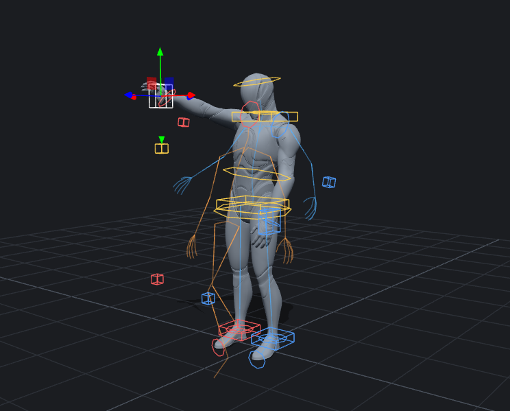

# SOMA Anim

キーポーズを置くだけでアニメーションを作る Web ツールです。キャラクターは UE5 Manny、リグは BNS 方式（`Rig_Manny_BNS`）。

- **タイムラインのキーは全身で 1 つ**。部位ごとのカーブは持たず、ポーズ単位で置く・動かす・コピーする・左右反転する。
- **ポーズを決めると自然な姿勢に直る**。手で動かしたコントロール（ピン）はそのまま、残りの体は参考モーションの一番近い姿勢になる。
- **キーとキーの間は NVIDIA MotionBricks が作る**。キー A までの動きとキー B のポーズを渡すと、その間の動きを生成モデルが出す（WebGPU、1 区間 0.1〜0.2 秒）。モデルが使えないときはモーションマッチング（参考モーションから A と B に合う区間を探す）で埋める。
- リグは Maya の `Rig_Manny_BNS.ma` を **そのまま再現**（88 ケースで誤差 0.01 cm 未満）。作ったアニメは Maya の同じリグへコントロール値のまま持っていける。



## 使い方

```
node tools/serve.mjs 8080
```

`http://127.0.0.1:8080/` を開く（ビルド不要。three.js は CDN から読む）。

| 操作 | 内容 |
|---|---|
| コントロールの線をクリック | 選択。移動だけのコントロールには矢印、回転だけのコントロールには輪が出る |
| 「全身」ボタン（足元の紫の輪） | 全身をまとめて動かす・回す `world_ctl`。`W` で移動、`E` で回転に切り替え |
| ドラッグを離す | そのフレームにキーができ、自然なポーズに直る（右上のチェックで切り替え） |
| `K` / `Delete` | 今のポーズをキーにする / キーを消す |
| タイムラインのキーをドラッグ | キーを移動（`Alt` + ドラッグでコピー） |
| `Ctrl+C` / `Ctrl+V` / `Ctrl+Shift+V` | ポーズのコピー / 貼り付け / 左右反転して貼り付け |
| `M` | 今のポーズを左右反転 |
| `N` | 今のポーズを自然に直す |
| `R` | 中割りを作り直す |
| `Space`、`←` `→`、`,` `.` | 再生、1 フレーム移動、前後のキーへ |
| `Ctrl+Z` / `Ctrl+Y` | 元に戻す / やり直す |

緑のコントロールは「ピン」（手で決めたもの）です。自動補正はピンを動かしません。右のパネルのチップをクリックすると外れます。
「足は今の位置に留める」を入れておくと、手や腰を動かしても足は滑りません。

「中割り」は 3 種類です。

| 中割り | 内容 |
|---|---|
| MotionBricks（既定） | 生成モデルがキーの間の動きを作る。初回だけモデル（約 380 MB）を NVIDIA の GitHub から取得し、ブラウザに保存する。準備ができるまではモーションマッチングで表示 |
| モーションマッチング | 参考モーションの区間をそのまま使う。帯にクリップ名が出る（`×0.80` は再生速度） |
| 単純な補間 | 参考モーションを使わない |

シーンはブラウザ（IndexedDB）に自動で保存され、次に開いたとき続きから始まります。「新規」で新しいシーンにします（`Ctrl+Z` で戻せます）。
自動補正が効きすぎるときは「強さ」を下げてください（既定 70%）。転倒・被弾・起き上がりのクリップは、自然なポーズの候補から外しています。

## Maya へ

「Maya 用に書き出し」で `soma_anim_bake.json`（全フレームのコントロール値）が保存されます。Maya で `Rig_Manny_BNS.ma` を開いて:

```python
import sys; sys.path.append(r"<このリポジトリ>/maya")
import soma_anim_import
soma_anim_import.load(r"C:/path/soma_anim_bake.json")                  # 全フレーム
# soma_anim_import.load(r"C:/path/soma_anim_bake.json", keys_only=True)  # キーポーズだけ
```

Web と Maya で同じ動きになることは `tools/maya_check.py` で確かめています（サンプル 76 フレームで関節位置の差 0.004 cm 未満）。

## 仕組み

```
コントロール値 ──(src/rig.js: BNS リグ)──> Manny の骨 ──> スキンメッシュ
      ▲
      │ src/fit.js（骨のポーズ → コントロール値）
      │
参考モーション DB（SOMA 骨格）──(src/retarget.js)──> Manny の骨のポーズ
      ▲
      ├─ src/natural.js   今のポーズに一番近いフレームを探す（ピンを重く比べる）
      ├─ src/inbetween.js キー A → キー B に合う区間を探し、両端をキーに合わせる
      └─ src/motionbricks.js キー A までの 4 フレームとキー B を MotionBricks に渡し、間の動きを生成
```

- **リグ**（`src/rig.js`）: Maya のシーンから書き出したノードグラフ（`assets/bns_rig.json`。コントロール 66、ノード 345、コンストレイント 89、IK 4、指の式、ツイスト骨）を、Maya と同じ規則で評価します。
- **自然なポーズ**（`src/natural.js`）: 手・足・頭の位置と腰の高さ（体の向きに合わせた座標）で DB を全探索。ピンに対応する項目は重みを 8 倍にします。
- **モーションマッチングの中割り**（`src/inbetween.js`）: DB の各フレーム i と n フレーム先の j について、`ポーズ(i) と A の差 + ポーズ(j) と B の差 + 移動量の差 + 向きの変化の差` が最小の区間を選びます（速度 0.5〜2 倍も候補）。転倒・被弾・起き上がりのクリップは使わず、区間の真ん中が両端の中間から大きく外れるものは選びにくくしています。区間をリグに載せ、両端の差を線形に減らしながら足してキーに一致させ、参考の中で接地している足はその場に留めます。
- **MotionBricks**（`src/motionbricks.js`, `src/mb_worker.js`）: キーのポーズを SOMA 骨格に移し、文脈 4 フレーム（前の区間の終わり。無ければキー A で静止）と目標 1 フレームをモデルに渡します。長さはトークン数（4 フレーム単位、24〜64 フレーム）で指定し、キーの間隔に合わせて時間を伸縮します。出力は両端をキーに合わせてからリグに載せ、モデルが出す接地の値で足を留めます。1 回に作れるのは 57 フレームまでなので、それより長い間隔は複数回の生成をつなぎます（途中は 2 つのキーの中間のポーズを目標にする。時間の引き伸ばしはしない）。
- **参考モーション DB**（`assets/motiondb.*`）: [soma-fighter-web](https://github.com/tomosud/soma-fighter-web) の `fightdb`（Mixamo 506 クリップを SOMA 骨格に移したもの）。

## 試験

```
node --test tests/
node tools/make_sample.mjs
mayapy tools/maya_check.py <Rig_Manny_BNS.ma> samples/sample_bake.json
```

- `tests/rig_cases.test.mjs`: リグが Maya の 88 ケースと一致すること
- `tests/fit.test.mjs`: DB のポーズをリグに載せたとき、腰・手・足が一致すること
- `tests/anim.test.mjs`: 左右反転が鏡像になること、自然化がピンを保つこと、中割りがキーに一致して飛ばないこと

## フォルダ

| 場所 | 中身 |
|---|---|
| `src/` | アプリ本体（ES modules、ビルドなし） |
| `assets/` | リグ、SOMA 骨格、参考モーション DB、Manny のメッシュ |
| `rigspec/` | Maya から書き出したリグの仕様と検証ケース（リグを作った Maya モジュール側の書き出しスクリプトで作成） |
| `maya/` | Maya への取り込み |
| `tools/` | サーバー、メッシュ変換、サンプル作成、Maya での確認 |

### Manny のメッシュ

`assets/manny.json` と `assets/manny.bin` は UE5 Manny（`SKM_Manny_Simple`、Epic Games のコンテンツ）のスキンメッシュです。`node tools/build_manny.mjs <target-character.json>` で作り直せます。
ファイルが無いとき、または `?mesh=0` を付けたときは、骨格から作ったマネキンで表示します。

## これから

- Maya 統合（Maya の中からこの画面を開いて、選択中のリグへ直接キーを打つ）
- 指のポーズの自然化、FBX の書き出し

ライセンスと出典は [NOTICE.md](NOTICE.md)。
