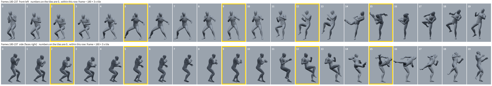
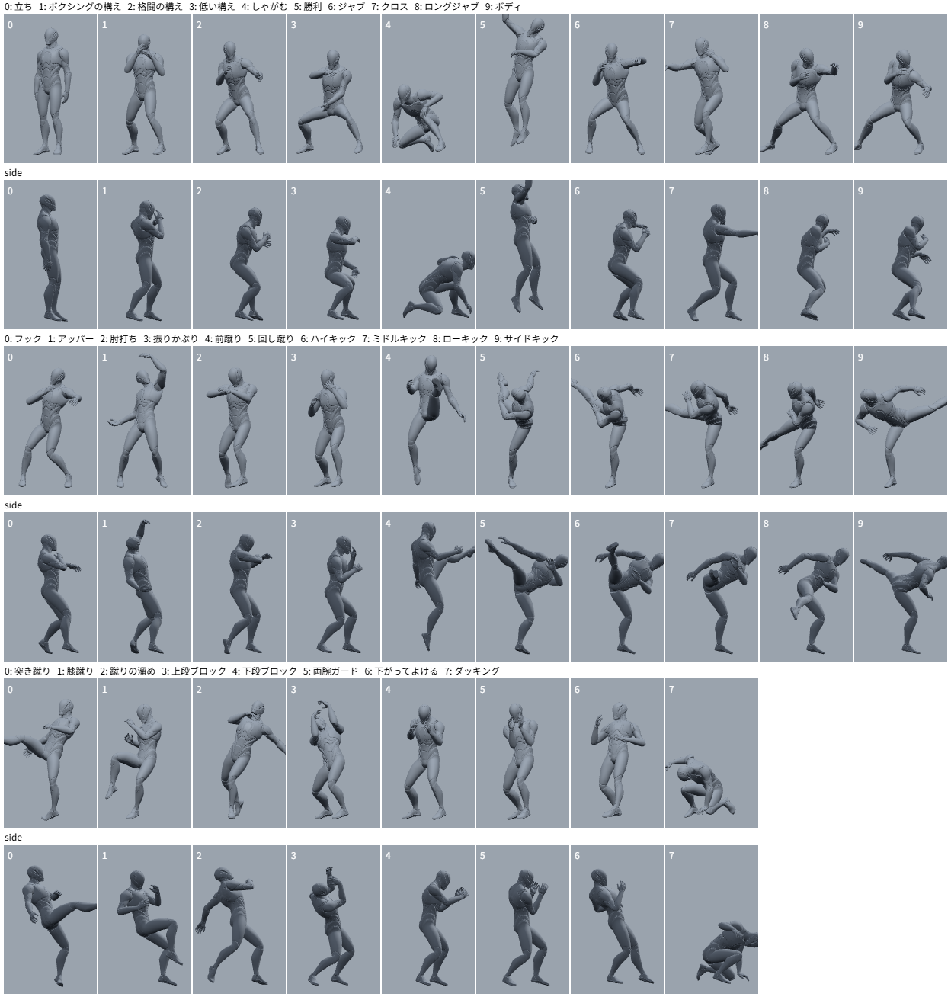

# SOMA Anim

キーポーズを置くだけでアニメーションを作る Web ツールです。キャラクターは UE5 Manny、リグは BNS 方式（`Rig_Manny_BNS`）。

- **タイムラインのキーは全身で 1 つ**。部位ごとのカーブは持たず、ポーズ単位で置く・動かす・コピーする・左右反転する。
- **ポーズを決めると自然な姿勢に直る**。動かしたコントロールはそのまま、体はそれについてくる（腰を下げれば胸・頭・腕も下がる）。編集した所の周り（肩、背骨、腰の寄せ）だけが参考モーションの近い姿勢になり、関係のない反対の手などは変えない。人が保てない姿勢（重心が足の外、手足が届かない、足が床の下）は直す。
- **キーとキーの間は NVIDIA MotionBricks が作る**（WebGPU、1 区間 0.1〜1 秒）。移動は歩行・走りとして作り、できた動きは採点して、余計な動作（跳ぶ、転がる、回る、頼んでいない身振り）が入ったものは採らない。モデルが使えないときと、キーの間隔が 5 フレーム未満のときは補間で埋める（そのときはタイムラインに理由が出る）。
- **ポーズの見本**（構え、パンチ、キック、防御、ジャンプ・宙返り、倒れる・寝る、日常の 62 ポーズ）をクリックで置ける。ジャンプや倒れるポーズは、そのキーの「足を床に着けて留める」を外して置くと、空中・寝た姿勢のまま置かれる。ヘッダーの「サンプル」は、見本だけで組んだ 300 フレームのアクション。
- リグは Maya の `Rig_Manny_BNS.ma` を **そのまま再現**（IK の照合 132 ケースで誤差 0.01 cm 未満）。重心（COG）、IK の追従先・肘と膝の向き・手首と足首の向きの切り替え、肩の自動追従も同じ。IK/FK の切り替えは IK に固定（FK は使わない）。作ったアニメは Maya の同じリグへコントロール値のまま持っていける。
- **ピッカー**は Maya のリグのピッカーと同じ配置で、ビュワーの右上に出ます（たためる。P キー。−／＋で大きさ、既定はビュワーの高さいっぱい。再生中は消える。文字は画面で 11 px 以上）。右の欄は「ポーズ」「見本」「表示」のタブ。コントロールを選ぶ、切り替える（ポーズは保つ）、肩の追従の強さ、ポーズ・指のリセット・コピー・反転。


## 使い方

```
node tools/serve.mjs 8080
```

`http://127.0.0.1:8080/` を開く（ビルド不要。three.js は CDN から読む）。

| 操作 | 内容 |
|---|---|
| コントロールの線をクリック | 選択。移動だけのコントロールには矢印、回転だけのコントロールには輪が出る |
| 「全身」ボタン（足元の紫の輪） | 全身をまとめて動かす・回す `world_ctl`。`W` で移動、`E` で回転に切り替え |
| ドラッグ | 腰・胸を動かすと、体（頭、腕）がついてくる。足は床に残る |
| ドラッグを離す | そのフレームにキーができ、自然なポーズに直る（右上のチェックで切り替え） |
| 「ポーズの自動補正」のチェック | 今のフレームのキーごとの設定（新しいキーはオン）。「動かしたら自然なポーズに直す」「足を床に着けて留める」 |
| 「ポーズの見本」のボタン | マウスを乗せると試しに表示、クリックで今のフレームのキーにする（`Shift` で左右反転）。体は全身コントロールの向きを向き、着いている足は今の位置に合う |
| `K` / `Delete` | 今のポーズをキーにする / キーを消す |
| 全身の輪（`world_ctl`）を `Shift` + ドラッグ | このキーと、それより後のすべてのキーをまとめて動かす・回す（回すと後のポーズは輪のまわりを回るように移る）。ドラッグ中は後のキーの骨を紫の線で表示 |
| タイムラインのキーをドラッグ | キーを移動（`Alt` + ドラッグでコピー、`Shift` + ドラッグでそのキーと後ろのキーをまとめて移動） |
| `Ctrl+C` / `Ctrl+V` / `Ctrl+Shift+V` | ポーズのコピー / 貼り付け / 左右反転して貼り付け。全身の位置と向き（`world_ctl`）は貼り付け先のまま |
| `M` | 今のポーズを左右反転 |
| `N` | 今のポーズを自然に直す |
| （ボタン） | ポーズをリセット: 開始ポーズ（力を抜いた立ち姿）に戻す。全身の位置と向き（`world_ctl`）はそのまま。位置も戻すときは「全身」を選んで「選択をリセット」 |
| 「輪を体の下へ」 | 全身の輪（`world_ctl`）を、すべてのキーで体の真下に置き直す。ポーズと動きは変わらない（腰をドラッグして体が輪から離れたときに）。見本から置いたポーズでは自動で行う |
| `G` | 足リセット: 両足を今の位置で床に着け、ねじれを戻す。脚が届かなければ腰を下げ、膝はつま先の向きへ |
| `R` | 中割りを作り直す |
| `Space`、`←` `→`、`,` `.` | 再生、1 フレーム移動、前後のキーへ |
| `Ctrl+Z` / `Ctrl+Y` | 元に戻す / やり直す |

緑のコントロールは「ピン」（手で決めたもの）です。ピンの部位は自動補正で形を変えません。右のパネルのチップをクリックすると外れます。
ピンにした手も、あとで腰や胸を動かせば体と一緒についてきます（その場に残るのは、いま動かしているコントロールと足だけ）。
「足は今の位置に留める」を入れておくと、手や腰を動かしても足は滑りません。腰を脚の届かない所まで動かしたときは、腰のほうが止まります。
「バランスと届く範囲を直す」は、人が保てない姿勢を直します: 重心が足の外にあれば腰を寄せる、手が届かなければ体を傾ける（傾けられるだけ。それ以上は届かないまま）、脚が届かなければ腰を寄せる、床の下の足は床の上へ。編集する前から崩れていたぶん（歩きの途中のポーズなど）は直しません。走りや跳躍の途中のような、わざと崩したポーズを作るときは外してください。

新しいシーンは、リグの A ポーズではなく、力を抜いた立ち姿（`assets/start_pose.json`）から始まります。A ポーズは人が動き出す姿勢ではないので、そこからの中割りは不自然になります。

「中割り」は 2 種類です。

| 中割り | 内容 |
|---|---|
| MotionBricks（既定） | 生成モデルがキーの間の動きを作る。初回だけモデル（約 380 MB）を NVIDIA の GitHub から取得し、ブラウザに保存する |
| 単純な補間 | モデルを使わない |

キーは「そこで止まるポーズ」です。MotionBricks の動きは、キーからキーまでの間隔ちょうどを使います（着いてからキーを待って立っている区間は作りません）。「キーを通過」を入れると、次のキーへ向かう勢いのまま通過します。

- **その場の動き**（手、しゃがむ、振り向く、1 m までの移動）: 1 回の生成で作ります。
- **58 フレームより長い間隔で移動がないとき**: 間のポーズを経由して、いくつかに分けて作ります。
- **移動**（0.9 m より遠く、28 フレーム以上）: 歩行として作ります。腰はキーからキーへまっすぐ、加速・等速・減速で進み、体は進む方向を向きます（両方のキーが反対を向いていれば後ろ歩き）。速ければ走りになります。両方のキーで同じ形の腕（上げた手など）は歩いている間も保ちます。
- **17 フレームより近いキー**（パンチの出入りなど）: モデルの最短の動き（17 フレーム）を作り、その間隔まで速めて使います。5 フレーム未満は補間（立っている足は留め、位置が変わる足は持ち上げて踏み替える）。
- **見本から置いたキー**: そのポーズは参考モーションの 1 フレームなので、前後のフレームもモデルに渡します（後ろの 3 フレームを目標に、前の 3 フレームを出どころに）。止まった姿勢ではなく「打っている途中」として生成されるので、体のひねりや体重移動が入ります。手で直したキーは、この情報を持ちません（全身の移動だけなら持ったまま）。

できた動きは毎回採点し、悪ければ別の作り方を試します（長さを変える、間のポーズで区切る、キーを「止まる姿勢」として渡す、腰の行き先だけを決めて体はモデルに任せる、など）。それでも跳ぶ・倒れる・回るなど崩れるときも、補間には落とさず、試した中で一番よい生成を使います（5 フレーム以上の間隔はいつも生成）。
そういう区間と、人には速すぎるキーの区間は、タイムラインの帯に注意（「MotionBricks（速すぎる）」「MotionBricks（跳んでしまう）」など）が書かれます。帯にマウスを乗せるか、クリックすると、何が問題か（例:「15 フレーム（0.5 秒）で 3.0 m 移動して止まるのは、人には速すぎます」）と、どう直せばよいか（例:「キーの間隔を 43 フレーム以上にする」）が出ます。補間（だいだい色の帯）になるのは、5 フレーム未満の間隔と、モデルの準備中・生成エラーのときだけです。
モデルの読み込み中は待ち画面が出ます（2 回目以降はブラウザに保存したものを使います）。

シーンはブラウザ（IndexedDB）に自動で保存され、次に開いたとき続きから始まります。「新規」で新しいシーン（300 フレーム）にします（`Ctrl+Z` で戻せます）。

### サンプル

ヘッダーの「サンプル」で `assets/sample_action.json` を開きます。構え → ジャブ → クロス → 踏み込んでアッパー → 回し蹴り → 下がってガード → ダッキングからボディ → 膝からハイキック → 立ち、の 24 キーです。
このツールの操作だけで作っています（フレームへ移動 → 見本をクリック、キーのコピー、全身コントロールの移動）。手順は `tools/make_action_sample.js` にそのまま書いてあります。
23 区間のうち 22 区間を MotionBricks が作っています（残りは 4 フレームの間隔）。



見本のポーズは参考モーションのフレームです（`tools/make_poses.mjs` が、拳がいちばん遠い・足がいちばん高い、などでフレームを選ぶ → `assets/poses.json`）。


自動補正が効きすぎるときは「強さ」を下げてください（既定 80%）。転倒・被弾・起き上がりのクリップは、自然なポーズの候補から外しています。

## 書き出し

- **FBX 書き出し**: Manny の 89 骨のアニメーション（メッシュなし、全フレームをベイク、cm・Y-up・30 fps）。Maya で開けて、Unreal では Manny のスケルトンに取り込めます。Maya で読み込んで Web と一致することは `tools/maya_fbx_check.py` で確かめています（差 0.001 cm 未満）。
- **Maya 用に書き出し**: リグのコントロール値のまま Maya の `Rig_Manny_BNS` に持っていく形式です（下）。

## Maya へ

「Maya 用に書き出し」で `soma_anim_bake.json`（全フレームのコントロール値）が保存されます。Maya で `Rig_Manny_BNS.ma` を開いて:

```python
import sys; sys.path.append(r"<このリポジトリ>/maya")
import soma_anim_import
soma_anim_import.load(r"C:/path/soma_anim_bake.json")                  # 全フレーム
# soma_anim_import.load(r"C:/path/soma_anim_bake.json", keys_only=True)  # キーポーズだけ
```

Web と Maya で同じ動きになることは `tools/maya_check.py` で確かめています（サンプル 76 フレームで関節位置の差 0.004 cm 未満）。

## 仕組み

```
コントロール値 ──(src/rig.js: BNS リグ)──> Manny の骨 ──> スキンメッシュ
      ▲
      │ src/fit.js（骨のポーズ → コントロール値）
      │
参考モーション DB（SOMA 骨格）──(src/retarget.js)──> Manny の骨のポーズ
      ▲
      ├─ src/natural.js    体をついてこさせ、編集箇所の周りに参考ポーズを入れる
      ├─ src/physical.js   バランス・届く範囲・床
      ├─ src/inbetween.js  生成した動きをリグに載せ、両端をキーに合わせ、足を留める
      └─ src/motionbricks.js MotionBricks で間の動きを生成し、採点して選ぶ
```

- **リグ**（`src/rig.js`）: Maya のシーンから書き出したノードグラフ（`assets/bns_rig.json`。コントロール 75、ノード 420、コンストレイント 124、IK 4、指の式（関節の範囲で止まる）、ツイスト骨、肩の自動追従の pairBlend）を、Maya と同じ規則で評価します。コンストレイントの重みは切り替えの値の式（例 `(L_Foot_rot.pvFollow == 1)`）で決まります。
- **関節の範囲**（`src/limits.js`, `assets/limits.json`）: 手首・肘・肩・足首・膝・股関節・首が、人の動く範囲（参考モーションの 4 万 2 千ポーズで人が取る範囲。`tools/make_limits.mjs`）を超えないようにします。キー（どう作ったものでも）、生成した中割り、ドラッグ中のすべてに効きます。手首と足首は範囲の端まで戻し、肩・肘・股関節・膝は手先・足先の位置を保ったまま肘や膝の向きを回して収めます。中割りで手首・足首・肘・膝の向きが 1 フレームで急に変わるところは、関節の角度の上で前後になだらかにつなぎます。「関節を人の動く範囲に収める」で切れます。
- **重心（COG）**（`src/cog.js`）: 見本を置いたキーと生成した中割りでは、COG を腰の位置に置きます（骨の位置は変えない）。キーで COG を腰から離してあれば、中割りではその離れ方を前後のキーの間でなだらかにつなぎます。ジャンプや宙返りは COG で体を運び・回すのがおすすめです。
- **切り替え**（`src/switches.js`）: follow・pvFollow・wristFollow・ankleFollow・autoShoulder はポーズの値の一部（キーごとに持つ。値 0 = 既定）。切り替えるときは、切り替えに左右されるコントロール（手足の IK、肘と膝の向き、肩、手首と足首）を元の世界の位置・向きに戻すので、ポーズが飛びません（Maya のツールと同じ）。中割りでは切り替えは補間せず、区間の始まりのキーの設定で作ります（前後のキーで違うときは、後ろのキーを同じ見た目のまま前のキーの設定に直してから）。
- **ピッカー**（`src/picker.js`, `assets/picker.json`）: Maya のリグのピッカーの書き出しから `tools/make_picker.mjs` で作ります（IK/FK のボタンと、Maya のツールを動かすだけのボタンは除く。指のタブは左手を右手の下に積む）。体と指のタブは同じ縮尺で描きます。
- **速さ**: リグはノードを読む順（依存の順）に並べ、本当に循環しているところ（足と足首）だけを収まるまで繰り返します（評価 1 回 0.14 ms、骨格からコントロール値への当てはめ 1.5 ms）。MotionBricks は GPU では 8 件を 1 回で推論し（8 件でも 1 件とほぼ同じ時間）、1 区間の作り方の候補を同時に作ってから、決まった順に採点して選びます。CPU（WASM）のときは 1 件ずつ。`node tools/bench_rig.mjs` でリグの速さを測れます。
- **自然なポーズ**（`src/natural.js`, `src/physical.js`）: このリグはほとんどのコントロールがワールドに置かれているので、腰を動かしても胸や手はその場に残ります。そこで骨格（関節の親に対する回転）の上で作業します。
  1. 編集前のポーズから、動かしたコントロールと足以外の関節を「親に対する回転を保ったまま」新しい腰の下に置き直す（体がついてくる。胸が傾いたとき、腕と頭は傾きの一部だけを受ける）。
  2. 手・足・頭の位置と腰の高さで DB を探し、近い 12 件のうち全身の変化が最も小さいものを選ぶ。
  3. その姿勢を、編集したコントロールからの近さで決めた割合だけ入れる（手を動かしたら同じ側の肩 100%、背骨 70%、腰 40%、反対の腕 10%、など）。DB に近い姿勢が無いときは割合を下げる。
  4. バランス・届く範囲・床を直す。
  5. リグに載せ直すのは、骨格の上で実際に動いた部位のコントロールだけ（編集のたびに少しずつずれるのを防ぐ）。
- **MotionBricks**（`src/motionbricks.js`, `src/mb_worker.js`）: キーのポーズを SOMA 骨格に移し、文脈 4 フレームと目標をモデルに渡します。素のモデルで確かめたこと（`tools/mblab.js`）と、それに合わせた作り:
  - 1 回の生成は 18〜58 フレーム。1 m 先までは人らしく動くが、1.5 m 以上を 1 回で行かせると飛び込みや前転になる → 遠くへは歩行として作る。歩行クリップの 4 フレーム（速度が伝わる）を、予定した道のりの約 1 秒先に置いてモデルに狙わせ、着く 10 フレーム前に次を作り直す（NVIDIA の実装が歩かせるやり方）。最後の区間だけキー B を狙う。遅い歩きは、歩幅とテンポを速度の平方根ずつ縮める。
  - リグの A ポーズや、ねじれの合っていない姿勢からは、腕を張るなど何でも出てくる → 開始ポーズを立ち姿にし、リグ → SOMA の変換で肢と背骨のねじれを較正する（`tools/make_retarget_cal.mjs`。参考ポーズ 1247 件をリグに載せて測った定数。較正前は前腕 24°、背骨 14°、太もも・すね 11° ずれていた）。
  - 生成結果はリグに載せてから `src/evaluate.js` で採点する（両足が浮く、腰がキーより上下する、体が倒れる、向きが外れる、キー間の道から外れる、キーで同じ位置の手や頭が勝手に動く、足が滑る）。作り方の候補（歩行、小分け、キーの間隔ちょうど、モデル任せの長さ）を順に試し、良いものが出たら採用、どれも悪ければ補間のほうが良いか比べる。
  - 出力は両端をキーに合わせ、モデルが出す接地の値で足を留める。最初の 1 回はシェーダーの準備に数秒かかるので、読み込みの待ち画面の間に済ませる。
- **参考モーション DB**（`assets/motiondb.*`）: [soma-fighter-web](https://github.com/tomosud/soma-fighter-web) の `fightdb`（Mixamo 506 クリップを SOMA 骨格に移したもの）に、見本用のジャンプ・宙返り 6 クリップ（Mixamo。soma-fighter-web の `tools/mixamo_clips.mjs` で SOMA 骨格に移したもの）を `tools/add_clips.mjs` で後ろに足しています（ポーズだけ。検索の項目は足さないので、自然化の結果は変わりません）。

## 自己テスト（動きの評価）

アニメーターが作る手順（開始ポーズから、コントロールを 1 つずつ動かしてキーを足す）で場面を作り、中割りして測り、絵にします。MotionBricks は WebGPU が要るので、ページの中で実行します。

```
node tools/serve.mjs 8080
# http://127.0.0.1:8080/?debug を開き、左上が「MotionBricks: ...」になったら、開発者コンソールで:
const t = await import('/tools/selftest.js');
await t.run();                       // 18 場面（手、しゃがむ、振り向く、歩く ...）
await t.run({ set: t.STRESS });      // 15 場面（遠く・速く・横へ・振り返って ...）
(await import('/tools/posetest.js')).draw();   // 自然なポーズ 27 件（node tools/posetest.js で数値だけ）
```

数値は 2 種類あります。**破綻**（足滑り、浮き、沈み、腰、傾き、向き、道から外れる、身振り）と、**動き方**です。動き方は、補間が「全身が同時に、まっすぐ、同じ加減速で動く」ことを使って測ります。

| 指標 | 意味 | 単純な補間 | サンプル（MotionBricks） |
|---|---|---|---|
| still | 何も動いていないフレームの割合 | 0.05 | 0.00 |
| snap | いちばん動く手足の、最高速 ÷ 平均速（打撃は 2〜3） | 1.48 | 1.78 |
| arc | その手足が、両端を結ぶ直線から離れる量（直線の長さ比） | 0.00 | 0.27 |
| overlap | 体の各部が最高速になる時刻のばらつき（区間の長さ比。0 = 全部同時） | 0.03 | 0.20 |

`eval_out/` に出るもの:

| ファイル | 中身 |
|---|---|
| `selftest.txt` / `.json` | 場面ごとの数値と、試した作り方・採点 |
| `strip_<場面>.png` | Manny の連番（斜め前からと真横から）。黄色の枠がキー、下の赤・青の印は右・左の足が床に着いている、上の赤い帯は指標が悪いフレーム |
| `heat_<方式>.png` | 何がどのフレームで悪いか（足滑り、浮き、沈み、腰、傾き、向き、道から外れる、身振り、参考から遠い、がたつき） |
| `pose_NN.png` | ポーズの編集前・編集そのまま・結果（正面と横） |

2026-11-11 の結果と経緯は [docs/eval_2026-11-11.md](docs/eval_2026-11-11.md)。

## 試験

```
node --test tests/
node tools/make_sample.mjs
mayapy tools/maya_check.py <Rig_Manny_BNS.ma> samples/sample_bake.json
```

- `tests/rig_cases.test.mjs`: リグが Maya の照合ケース（IK のもの 132 件）と一致すること。ケースは `rigspec/`（手元だけ。このリポには入れない）にあるときだけ走ります
- `tests/fit.test.mjs`: DB のポーズをリグに載せたとき、腰・手・足が一致すること
- `tests/anim.test.mjs`: 左右反転が鏡像になること、自然化が編集したコントロールと関係のない手を保つこと、腰を下げると体がついてくること、保てない姿勢が直ること、補間の足が滑らないこと

## フォルダ

| 場所 | 中身 |
|---|---|
| `src/` | アプリ本体（ES modules、ビルドなし） |
| `assets/` | リグ、SOMA 骨格、参考モーション DB、Manny のメッシュ |
| `rigspec/` | Maya 側から受け取るリグの資料（仕様・照合ケース・規則・ピッカー）。**手元だけ**に置き、このリポには入れない（`.gitignore`） |
| `maya/` | Maya への取り込み |
| `tools/` | サーバー、メッシュ変換、サンプル作成、Maya での確認 |

### Manny のメッシュ

`assets/manny.json` と `assets/manny.bin` は UE5 Manny（`SKM_Manny_Simple`、Epic Games のコンテンツ）のスキンメッシュです。`node tools/build_manny.mjs <target-character.json>` で作り直せます。
ファイルが無いとき、または `?mesh=0` を付けたときは、骨格から作ったマネキンで表示します。

## これから

- Maya 統合（Maya の中からこの画面を開いて、選択中のリグへ直接キーを打つ）
- 指のポーズの自然化
- しゃがんだままの移動（今は途中で立ち上がる）、横歩き（今は向きを変えて歩く）、歩き出しと止まり際の質

ライセンスと出典は [NOTICE.md](NOTICE.md)。
