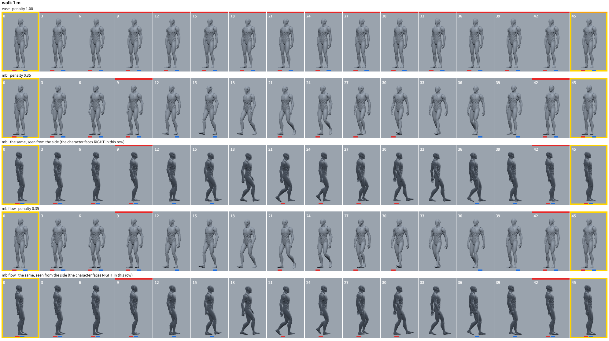
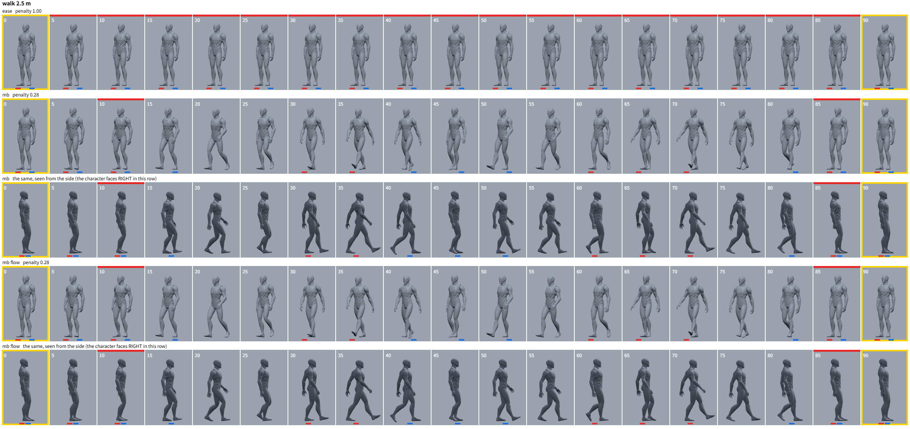
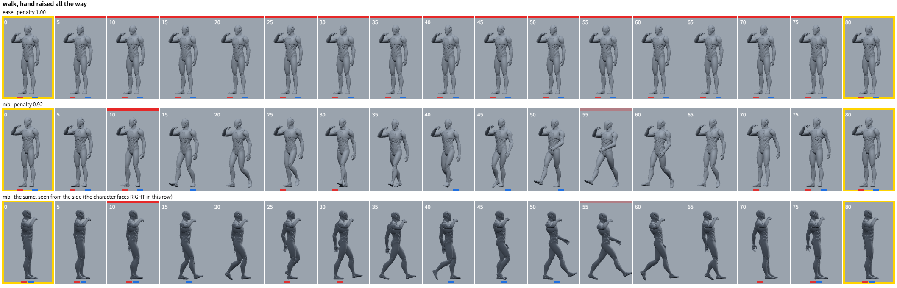
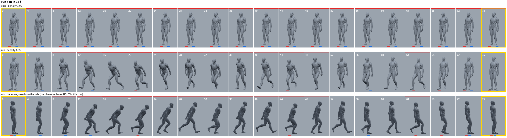
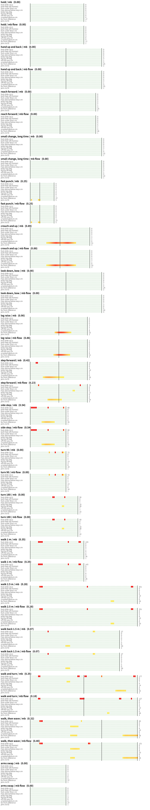
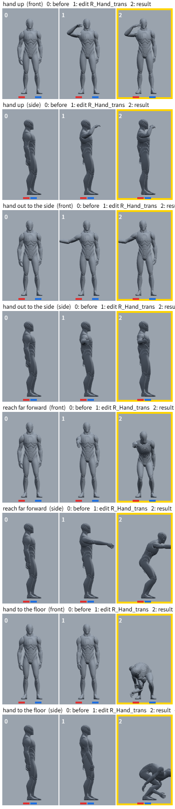

# 評価の記録（2026-11-11）

自然なポーズと中割りを作り直したときの、評価の方法・分かったこと・結果です。
数値と絵は `tools/selftest.js`（中割り）と `tools/posetest.js`（ポーズ）が `eval_out/` に出したものです。

## 評価の方法

- 場面は、アニメーターが作る手順で作る（開始ポーズから、コントロールを 1 つずつ動かしてキーを足し、そのつど自然化する）。
- 数値: 足滑り、両足が浮く長さ、床へのめり込み、腰の上下、体の傾き、向きの外れ、キー間の道からの外れ、頼んでいない身振り、参考モーションからの遠さ、がたつき（`src/evaluate.js`）。
- 絵: Manny の連番（斜め前と真横）と、指標ごと・フレームごとのヒートマップ。
- 絵は別のモデル（Opus / Sonnet）に、アニメーターの目で場面ごとに GOOD / MINOR / BAD を付けさせ、指摘を直して回し直す。これを 4 巡。

## MotionBricks が前転・ジャンプ・不自然な移動を出していた理由

素のモデルを条件を変えて呼んで調べました（`tools/mblab.js`）。

| 分かったこと | 対策 |
|---|---|
| 1 回の生成（18〜58 フレーム）で 1 m 先までは人らしく動く。1.5 m 以上を 1 回で行かせると、飛び込み・前転・跳躍になる | 0.9 m より遠くへは歩行として作る（歩行クリップの 4 フレームを道のりの約 1 秒先に置いて狙わせ、着く前に作り直す。NVIDIA の実装の歩かせ方） |
| 以前は遠い移動の経由点に、格闘の参考モーションから探した区間（回転、突進など）の姿勢を置いていた。1 m の移動が回転ステップになっていた | 参考モーションの区間探しをやめ、歩き・走り・後ろ歩きの 3 クリップだけを目標にする |
| リグの A ポーズ（新規シーンの最初のキー）からは、腕を横に張る動きが出る | 開始ポーズを、参考モーションの立ち姿にする |
| リグ → SOMA の変換で、前腕 24°、背骨 14°、太もも・すね 11° のねじれのずれがあった。モデルには見慣れない姿勢に見え、腕を張る癖の原因になっていた | 参考ポーズ 1247 件から定数を測って較正（`assets/retarget_cal.json`） |
| 速い歩行クリップをゆっくり再生して目標にすると、歩幅だけ大きい「突き」のような歩きになる | 歩幅とテンポを速度の平方根ずつ縮める |
| それでも外れは出る | 結果を採点し、別の作り方を試し、どれも悪ければ補間にする |

## 結果

通常の 18 場面（減点の合計。0 が良い）:

| | 補間 | MotionBricks |
|---|---|---|
| 作業前 | 12.9 | 14.5 |
| 作業後 | 12.6 | 4.4 |

作業後の 4.4 のうち 3.0 は「参考モーションから遠い」（しゃがみ・脚上げなど、キーのポーズ自体が参考に無い）で、動きの破綻ではありません。

レビュー（Opus、最終）: 18 場面のうち GOOD 8、MINOR 10、BAD 0。
「最初のたたき台として受け入れられる。新しく作り出された動き、足の浮き、跳ねは無い。その場の動きと旋回はそのまま使える。移動は手直し前提」。

負荷の高い 15 場面（2.5 m を 40 フレームで、5 m を走る、横へ 2 m、振り返って 2 m、など）のレビュー: 飛び込み前転・ジャンプ・スピン・その場走りは無し。

ポーズ（27 件のうち一部）:

## 残っていること

- 歩き: 頭が前に出る前傾（10〜15°）と、やや大きめの歩幅が残る。歩き出しの溜めが長く、止まり際が急。
- 後ろ歩き: 最初の 1 歩が大きく、歩幅がそろわない。
- しゃがんだままの移動: 途中で立ち上がる（しゃがみ歩きのクリップは向きが合わず使えなかった）。
- 横へ遠く: 向きを変えて歩き、最後に向きを戻す（横歩きのまま進むことはできない）。
- 2.5 m を 40 フレームのような無理な速さ: 走りにはなるが、走り出しが低く、止まり際の踏ん張りが無い。
- 「一歩前へ」: 足を 70 cm 前に置くキーは構えが大きく、間で止まって見える。
- 床に手をつく: 体を丸めすぎる。
- パンチやしゃがみのキー自体は、体重移動やひねりが入らず硬い（腕や腰を 1 つ動かしただけでは、そこまでは作らない）。
